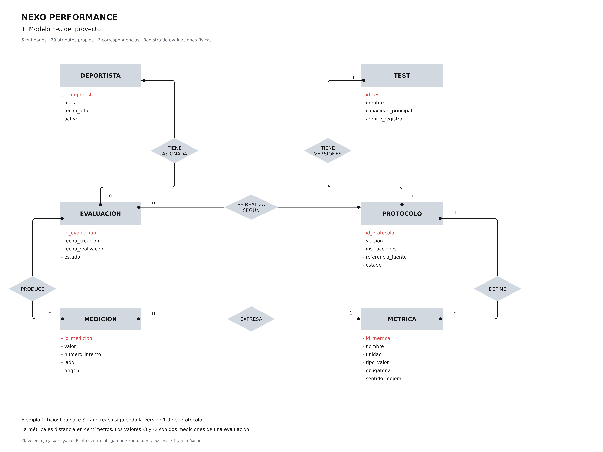

# Revisión del modelo E-C definitivo

Fecha de comprobación: 31 de octubre de 2026.

La imagen `docs/modelo-er.png` corresponde al diseño de Canva
`DAHZft_cIAg`, titulado «NEXO · E-C definitivo · TEST y EVALUACIÓN
obligatorios». Conserva el estilo con atributos en listas elegido por el grupo.
Es el mismo PNG de 4800 × 3600 que utiliza la aplicación.

## Qué cambia respecto a la versión anterior

Se han corregido dos participaciones mínimas, moviendo sus puntos dentro de
los rectángulos:

- TEST, en TIENE VERSIONES: todo test tiene al menos un protocolo.
- EVALUACION, en PRODUCE: toda evaluación guardada tiene al menos una medición.

Los máximos 1:n, las seis entidades, los 28 atributos propios y las seis
correspondencias se mantienen. Una evaluación todavía sin mediciones es un
borrador en pantalla; se guarda junto con su primera medición.

## Lectura de las correspondencias

Los números 1 y n expresan máximos. El punto dentro indica participación
obligatoria; el punto fuera, opcional.

| Correspondencia | Lectura en ambos sentidos | Clave ajena resultante |
| --- | --- | --- |
| DEPORTISTA TIENE ASIGNADA EVALUACION | Un deportista tiene 0..n evaluaciones; cada evaluación corresponde a un deportista. | evaluacion.id_deportista → deportista.id_deportista |
| TEST TIENE VERSIONES PROTOCOLO | Un test tiene 1..n protocolos; cada protocolo pertenece a un test. | protocolo.id_test → test.id_test |
| EVALUACION SE REALIZA SEGÚN PROTOCOLO | Cada evaluación sigue un protocolo; un protocolo puede utilizarse en 0..n evaluaciones. | evaluacion.id_protocolo → protocolo.id_protocolo |
| PROTOCOLO DEFINE METRICA | Un protocolo define 1..n métricas; cada métrica pertenece a un protocolo. | metrica.id_protocolo → protocolo.id_protocolo |
| EVALUACION PRODUCE MEDICION | Una evaluación produce 1..n mediciones; cada medición pertenece a una evaluación. | medicion.id_evaluacion → evaluacion.id_evaluacion |
| MEDICION EXPRESA METRICA | Cada medición corresponde a una métrica; una métrica puede tener 0..n mediciones. | medicion.id_metrica → metrica.id_metrica |

## Comparación con las tablas reales de Supabase

Se consultaron únicamente los metadatos de las seis tablas del modelo y tres
recuentos de coherencia. En este paso no se han cambiado tablas ni datos.

- Las seis tablas coinciden con el modelo: deportista, test, protocolo,
  evaluacion, metrica y medicion.
- Los 34 campos coinciden en nombre y tipo: 28 atributos propios más seis
  claves ajenas.
- Las seis claves primarias y las seis claves ajenas corresponden a las
  previstas. Las claves ajenas no admiten nulos y emplean ON DELETE RESTRICT.
- Se conservan las restricciones de unicidad de test/version y de
  evaluacion/metrica/numero_intento/lado.

Resultado de las consultas del 31 de octubre de 2026:

| Comprobación | Casos encontrados |
| --- | ---: |
| Tests sin protocolo | 0 |
| Evaluaciones sin mediciones | 0 |
| Mediciones cuya métrica pertenece a otro protocolo | 0 |

El punto de participación obligatoria de TEST no se garantiza solo mediante
la clave ajena de PROTOCOLO; tampoco el de EVALUACION se garantiza solo con
la clave ajena de MEDICION. La base de datos dispone de comprobaciones
adicionales para esos mínimos. La pertenencia de la métrica al protocolo de
la evaluación también es una regla adicional al dibujo.

La revisión de la imagen no exigía cambiar las tablas: ya estaban alineadas.
Posteriormente se adaptaron y aplicaron 001 y 002 para reconocer esa misma
estructura y limitar los permisos del servidor, sin modificar el modelo ni
los datos. El cierre está en [Aplicación en Supabase](aplicacion-supabase.md).

## Identificación del archivo

- PNG: 4800 × 3600 píxeles.
- SHA-256: `6532d000ffde16807c5a31366cd7e613431dee906bd7dfe59217c6f00bdddf0c`.
- Modelo conceptual: seis entidades, 28 atributos propios y seis
  correspondencias binarias 1:n.
- Transformación: seis tablas, 34 campos y seis claves ajenas.
